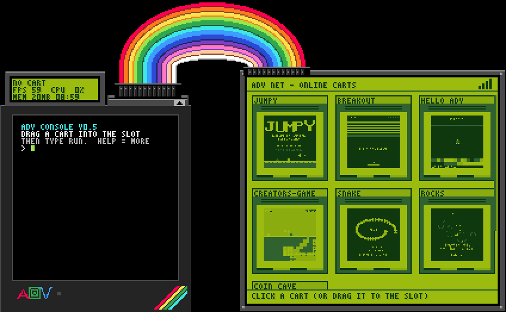

# ADV: a little fantasy console

### ▶ Play it now: **https://ilikehomeassistant.github.io/adv-web/**

### 🎉 ADV 1.0 is out: online play for up to 4! Windows, Android and the web, all in one game. [Watch the trailer](https://github.com/Ilikehomeassistant/adv-web/releases/download/v1.0/ADV-v1.0-trailer.mp4) · [What's new](https://github.com/Ilikehomeassistant/adv-web/releases/tag/v1.0)



ADV is a pretend retro games machine with tiny limits that make games fun to make and fun to play:

- a **128 x 128** screen in **24 colors**, plus a little green LCD on top that games can draw on too
- **4-channel chip sound** with slides, vibrato and arpeggios
- **2 players** on one keyboard (or a phone, Game Boy-style), and **online play for up to 4**: host a game, send the code, play. Same Wi-Fi? No code needed.
- games written in **Lua**, built from **Scratch-style blocks**, or made with the **game kit**: say which sprite is the player, the enemies, the coins and the walls, paint a map, and that's a game. No code needed.

**Every cartridge is a picture.** A cart is a colorful square that looks a bit like a QR code, with the whole game hidden inside, error correction and all. Share it like any other picture, and anyone can drop it into ADV and play it.

## Make a game

Open the **[Developer Kit](https://ilikehomeassistant.github.io/adv-web/devkit.html)** in your browser (PC), or download it for Windows. It has editors for code, sprites, maps, sound effects and music. When your game's done, type `UPLOAD` and the dev kit's modem sends it to [adv-carts](https://github.com/Ilikehomeassistant/adv-carts), where it can go online for everyone to play. See [how to submit a cart](https://github.com/Ilikehomeassistant/adv-carts/blob/main/CONTRIBUTING.md).

## Downloads

ADV for **Windows**, the **Developer Kit** for Windows, and ADV for **Android** are on the [releases page](https://github.com/Ilikehomeassistant/adv-web/releases/latest). Free.

## Link to ADV

Got a website? Here's a button: 

```html
<a href="https://ilikehomeassistant.github.io/adv-web/"></a>
```

Want ADV *on* your site? [ADV Lite](https://ilikehomeassistant.github.io/adv-web/indieweb.html) is a little handheld of ADV's online games that you can paste into any page.

## About this repo

This is the built website. On a PC you get the desk (the console wired to a screen of online carts), and on a phone the handheld. Add `?mode=phone` or `?mode=pc` to choose.

Made by atomicdude, inspired by [PICO-8](https://www.lexaloffle.com/pico-8.php).
